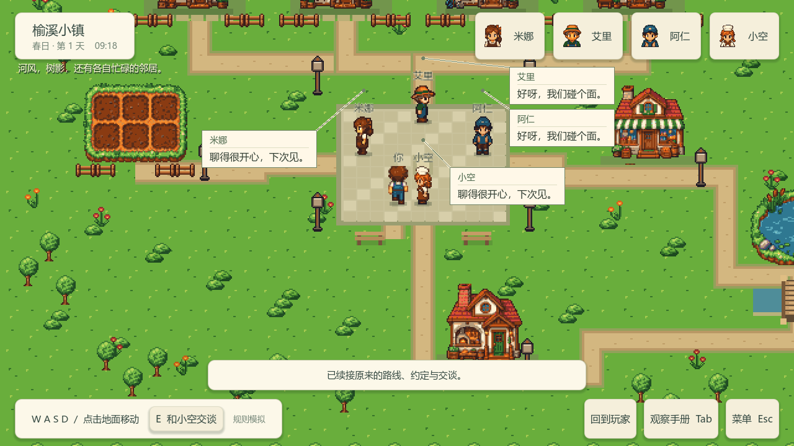
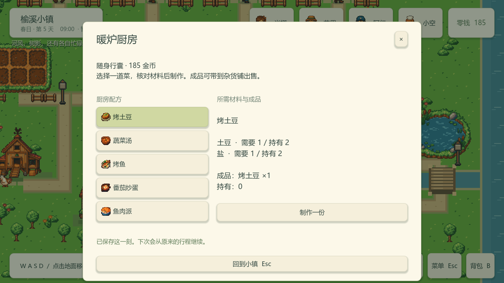

# CozyTown Godot

CozyTown 是一个探索 **AI Agent 如何在游戏世界里生活、互动与协作** 的小镇 Demo。

我希望把 Agent 放进一个可以亲自游玩的小世界，观察它们在时间、资源和信息有限的情况下如何做决定：一次邀请能否变成赴约，一次交谈能否促成合作，保存并继续之后，居民能否接上原来的生活。通过记录和回放这些过程，可以比较不同决策带来的结果，帮助定位行动失败的原因。

这里是独立的 Godot .NET 版本，面向 Windows/PC，使用 C# 编写世界规则与模型接口。完整目标见[产品基线](docs/PRODUCT_BASELINE.md)。

## 现在可以做什么

- **过一段小镇生活**：购买种子和饲料，种植、浇水、养鸡、钓鱼，把收获做成料理或拿到商店出售，再投入下一轮生产。
- **与四位居民相处**：Mina、Eli、Ren、Sora 有各自的日程、资源和经历，会发起或回应邀请、按约定见面、交谈和交换资源；玩家也能走近他们聊天。
- **保存后继续**：保存玩家与居民的逻辑状态，读取后继续行程、互动和生产。
- **观察与复现实验**：查看居民正在做什么，导出运行记录，再用离线回放核对过程、定位分歧。

默认模式用离线规则驱动居民，玩家对话中的生成入口使用固定示例。接入真实模型后，模型可以参与居民行动选择和玩家交谈；它提出的行动要通过世界规则检查后才会执行。

## 小镇一瞥



四居民交谈界面，来自 [Godot 离线演示](docs/verification/four-resident-slice.md)。



把收获带到厨房，查看配方、核对材料并制作食物。截图来自[生产玩法演示](docs/verification/player-production.md)。

## 从源码运行

准备 Windows x64、Git 和 PowerShell 7（`pwsh`），然后在 PowerShell 中运行：

```powershell
git clone https://github.com/qinjunw/CozyTown-Godot.git
cd CozyTown-Godot
pwsh -File tools/windows/install-toolchain.ps1
pwsh -File tools/windows/verify.ps1
```

安装脚本会下载 Godot 4.7.2 .NET、导出模板和 .NET SDK 10.0.401 到 `.local/tools/`；首次构建还需要访问 NuGet。固定版本与下载摘要见 [toolchain.lock.json](tools/windows/toolchain.lock.json)。

`verify.ps1` 会构建项目、运行自动检查并导出 Windows 程序。验证成功后，终端的 `Evidence:` 会给出本次输出目录 `artifacts/verification/<run-id>/`。打开其中的 **`windows/CozyTown.exe`** 即可进入小镇；请保留整个 `windows/` 目录，运行时文件也在其中。

基本操作：WASD／方向键移动，E 交互，B 打开背包，Tab 打开观察手册，Esc 打开菜单，F5 保存、F9 读取。退出重开后需要按 F9 恢复存档。完整操作见[小镇玩法](docs/PLAYABLE_SLICE.md)；在编辑器中开发与构建参数见 [Windows 工具链说明](docs/WINDOWS_TOOLCHAIN.md)。

也可以按[下载指引](docs/WINDOWS_DELIVERY.md)取用 main CI 生成的 Windows 候选包，解压后运行 `Start-Playtest.cmd`，无需安装 Godot 或 .NET SDK。Actions 候选需要登录 GitHub 下载，保留 14 天；公开发布的版本见 [Releases](https://github.com/qinjunw/CozyTown-Godot/releases)。

## 配置真实模型（可选）

普通玩法和离线实验无需模型密钥。当前真实模型适配器使用 **DeepSeek**，启用前需要准备服务凭据、模型配置和调用预算：

1. 按[模型配置模板](src/CozyTown.Model/manual-play.example.json)填写本机配置，指定凭据文件与预算账本，使用 `manual-play-v1` 试玩配置。预算账本的创建和使用见[模型与预算说明](src/CozyTown.Model/README.md)。
2. 按[启动配置模板](tools/CozyTown.Play/launcher.example.json)绑定 Windows 程序目录，设置真实模式与离线模式各自的数据目录。
3. 按[真实模型试玩指南](docs/REAL_PLAY_LAUNCHER.md)完成预检并生成双击入口，再用 `Start-Real-Model.cmd` 启动。

凭据和预算账本保存在仓库外，本机配置放在忽略的 `.local/` 目录。真实模式启动后，居民自主请求与玩家生成反馈都会计入调用预算；读档会沿用同一账本。

## 继续了解与开发

| 想了解的内容 | 从这里开始 |
| --- | --- |
| 商店、种植、养鸡与料理 | [经济](docs/PLAYER_ECONOMY.md)、[种植与睡眠](docs/PLAYER_FARMING.md)、[生产](docs/PLAYER_PRODUCTION.md) |
| 世界规则、居民逻辑和场景组织 | [架构索引](docs/ARCHITECTURE.md)、[内容编辑](docs/CONTENT_AUTHORING.md)、[领域术语](CONTEXT.md) |
| 对话、保存和实验回放 | [玩家对话](docs/PLAYER_DIALOGUE.md)、[保存恢复](docs/SAVE_REPLAY_CONTRACT.md)、[核心回放](docs/REPLAY.md)、[场景回放](docs/SCENE_REPLAY.md) |
| 自动验证、人工试玩与实验结果 | [完整 Demo 验证](docs/FULL_DEMO_RUN.md)、[试玩清单](docs/PLAYTEST.md)、[验收与实验记录](docs/DEMO_ACCEPTANCE_MAP.md) |
| 当前任务与参与开发 | [GitHub Issues](https://github.com/qinjunw/CozyTown-Godot/issues)、[协作流程](docs/wayfinder/github-tracker.md) |

Core 负责世界规则与逻辑状态，Model 负责模型传输与预算，Godot Host 负责场景、输入和界面。实验与验收结果按各自版本记录，具体范围见上面的验证文档。

## 来源与许可

项目沿用了 CozyTown Unity 版本的小镇与 Agent 实验目标，并参考其行为、测试和素材，使用独立工程与存档格式。Godot 版本可独立构建和运行。参考版本见[产品基线](docs/PRODUCT_BASELINE.md#参考基线与来源)，素材来源与版本见[美术来源](docs/art/SOURCES.md)。

本仓库尚未提供项目许可证。素材的来源记录与许可状态见 [美术来源](docs/art/SOURCES.md)；公开可见性不替代项目或素材的许可声明。
