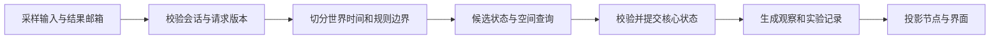

# Godot 世界时序、人物身体与独立核心的边界

研究日期：2026-09-19。对应票据：[研究 Godot 世界时序、人物身体与独立核心的边界](https://github.com/qinjunw/CozyTown-Godot/issues/3)。

本文提供官方能力核验、方案比较和待验证建议，不声明 Godot Demo、测试或导出已经完成。研究没有安装或运行 Godot，也没有调用模型。已确认的项目约束是 Windows/PC 优先、Godot .NET、独立 C# 核心和新存档；Unity 的坐标、物理参数、类型与旧档均不是兼容目标。产品目标见[产品基线](../PRODUCT_BASELINE.md)，领域词义见[CONTEXT](../../CONTEXT.md)。

能力核验以 Godot **4.7.2-stable** 源码和 **4.7** 官方文档为依据。[发行说明](https://godotengine.org/article/maintenance-release-godot-4-7-2/)确认该版本于 2026-08-18 发布。文档的版本入口仍可能修订；源码引用固定到发行标签。这里的版本是研究输入，安装、SDK 与导出验证由工具链研究负责。

## 研究结论与方案比较

建议采用“独立核心持有权威世界与路线状态，Godot 单一宿主提供时间输入、空间查询和显示”的边界。第一轮原型需要证明同一输入在连续运行、暂停恢复、保存读取和记录回放下保持约定结果；在原型前不把这一方案写成已经验证的架构。

| 方案 | 状态与执行边界 | 优点 | 本项目的代价与适用条件 |
| --- | --- | --- | --- |
| A：节点承载人物行为 | 经济规则在核心；日程、导航、会话和执行状态分散在节点 | 容易直接使用节点和编辑器行为 | 完整快照要跨节点收集，回调顺序进入业务语义，纯 C# 回放不足以重建人物；不建议作为首版主边界 |
| B：核心承载世界与路线，Godot 执行空间适配 | 核心保存意图、活动、路线游标、承诺、会话及待办；Godot 返回带版本的查询结果并投影已提交状态 | 可以单独测试规则和续接；继续使用 Godot 场景与碰撞能力 | 需要显式宿主顺序、几何查询合同和投影失败处理；**建议先验证此方案** |
| C：核心还承载全部碰撞几何与求解 | Godot 只显示；移动、相交和导航全部在核心 | 无引擎场景也能重新计算身体结果 | 需维护几何、碰撞、编辑器导出的一致性；在 B 的回放或吞吐测量确实不满足目标前，不扩大到此方案 |

这些是项目方案推断，不是 Godot 官方推荐。B 不要求为多引擎制作通用框架，也不要求沿用 Unity 手写的每一个算法。首版的地图、行走与交互方式仍应由实际原型决定。

## 官方事实与项目含义

| 主题 | 已核验的引擎或运行时事实 | 对本项目的约束 |
| --- | --- | --- |
| 主循环 | `_Process` 随渲染帧率调用；`_PhysicsProcess` 按固定频率、在物理步前调用，默认 60 次/秒。二者不是同一时序。[处理回调](https://docs.godotengine.org/en/4.7/tutorials/scripting/idle_and_physics_processing.html) | 世界提交由一个宿主排序，显示帧不能自行推进经济或居民日程 |
| 时间缩放 | `Engine.TimeScale` 影响使用 delta 的处理及计时器，但不会自动提高物理频率；高倍率会扩大每步模拟跨度。每渲染帧还有物理步数量上限。[Engine](https://docs.godotengine.org/en/4.7/classes/class_engine.html#class-engine-property-time-scale) | 游戏时间倍率、睡眠与网络超时不能共用这个全局开关 |
| 暂停 | `SceneTree.Paused` 默认停止物理；节点是否处理由 ProcessMode 决定。停止处理的节点仍能接收信号。[暂停机制](https://docs.godotengine.org/en/4.7/tutorials/scripting/pausing_games.html) | 暂停不等于禁止世界写入；信号入口还需项目自己的状态检查 |
| 线程 | 活动 SceneTree 的交互不是线程安全的；官方提供 `CallDeferred` 等安排主线程操作的方法。[线程安全 API](https://docs.godotengine.org/en/4.7/tutorials/performance/thread_safe_apis.html) | 后台网络工作返回数据，不能直接改节点或权威世界 |
| C# continuation | 发行源码中的 `GodotSynchronizationContext.Post` 将回调入队；`GodotTaskScheduler.Activate` 执行排队任务和 continuation。[同步上下文源码](https://github.com/godotengine/godot/blob/4.7.2-stable/modules/mono/glue/GodotSharp/GodotSharp/Core/GodotSynchronizationContext.cs)、[调度器源码](https://github.com/godotengine/godot/blob/4.7.2-stable/modules/mono/glue/GodotSharp/GodotSharp/Core/GodotTaskScheduler.cs) | continuation 被调度不代表它发生在本项目定义的世界提交边界 |
| C# await 与取消 | `await` 的上下文捕获取决于调用环境与配置；`ConfigureAwait(false)` 不要求回到原上下文。取消是协作请求，监听方负责响应。[Microsoft await 说明](https://devblogs.microsoft.com/dotnet/configureawait-faq/)、[取消模型](https://learn.microsoft.com/en-us/dotnet/standard/threading/cancellation-in-managed-threads) | 不以“用了 await”证明主线程安全，不以取消成功证明旧结果永远不会到达 |
| 节点生命周期 | 父节点先 EnterTree，子节点先 Ready；移出后重新加入通常不会再调用 Ready。QueueFree 延后删除节点及其子节点。[Node](https://docs.godotengine.org/en/4.7/classes/class_node.html) | 世界会话的开始、退役和重新绑定需要显式处理，不能只依赖 Ready |
| C# 信号清理 | 捕获变量的 lambda、通过事件方式连接的自定义信号存在不会自动断开的情形。[C# signals](https://docs.godotengine.org/en/4.7/tutorials/scripting/c_sharp/c_sharp_signals.html#disconnecting-automatically-when-the-receiver-is-freed) | 保存 delegate 并在会话退出时解除订阅，防止重载后的重复处理 |
| 空间查询 | 官方建议在物理处理时查询空间，因为其他时段空间可能锁定。`CastMotion` 返回安全/不安全运动比例，但忽略起点已重叠的形状；应另查重叠。[查询时机](https://docs.godotengine.org/en/4.7/tutorials/physics/ray-casting.html)、[PhysicsDirectSpaceState2D](https://docs.godotengine.org/en/4.7/classes/class_physicsdirectspacestate2d.html#class-physicsdirectspacestate2d-method-cast-motion) | 移动前和读档预检都需区分“起点非法”与“前方有障碍” |
| 接触观察 | Area2D 的重叠列表随物理步更新，不会在每次改位置后立即更新。[Area2D](https://docs.godotengine.org/en/4.7/classes/class_area2d.html#class-area2d-method-get-overlapping-bodies) | 不能在传送或读档后立即把旧重叠列表当作到场证据 |
| 导航 | NavigationAgent 可选；查询路径并不移动父节点。寻路需等待地图同步，回调要按物理步维护。避让独立于物理碰撞和寻路。[NavigationAgents](https://docs.godotengine.org/en/4.7/tutorials/navigation/navigation_using_navigationagents.html) | 导航结果是候选路线，不能直接代表已到场、能交付或不会穿墙 |
| 保存能力 | 官方展示 FileAccess 与 JSON 存档；JSON 需要显式转换引擎向量等类型。ResourceSaver 可以保存 Resource 为文本或二进制资源。[保存教程](https://docs.godotengine.org/en/4.7/tutorials/io/saving_games.html)、[ResourceSaver](https://docs.godotengine.org/en/4.7/classes/class_resourcesaver.html) | 这些是编码与存储能力，完整逻辑快照的范围和事务仍由项目定义 |

## 从参考项目保留的合同

仅以参考提交 [CozyTown 68a1dde](https://github.com/qinjunw/CozyTown/tree/68a1dde7c7099f3e9ee7e975141d0bf9d18099aa) 为证据，未引用其未提交美术变更。

- [WorldTimeFlow](https://github.com/qinjunw/CozyTown/blob/68a1dde7c7099f3e9ee7e975141d0bf9d18099aa/Assets/CozyTown/Runtime/Time/WorldTimeFlow.cs)区分世界同步、显示发布和恢复失败；这说明“时间已推进”与“节点已经正确显示”是两个结果。新宿主也需能定位这两类失败。
- [TownRouteFollower2D](https://github.com/qinjunw/CozyTown/blob/68a1dde7c7099f3e9ee7e975141d0bf9d18099aa/Assets/CozyTown/Unity/Town/TownRouteFollower2D.cs)保存当前位置、朝向、路点、游标、阻塞和重规划状态，同时调用 Unity 物理查询。可保留“途中继续”的行为目标；不能把原类当作独立核心直接引用。
- [CozyTownTownLifeController](https://github.com/qinjunw/CozyTown/blob/68a1dde7c7099f3e9ee7e975141d0bf9d18099aa/Assets/CozyTown/Unity/Npc/CozyTownTownLifeController.cs)验证身体、会面和世界时间关系，且把完整快照绑定到四名居民与 BodyConfiguration。新项目保留跨系统一致性，重新定义配置标识；不保留 Unity 类型名、Collider 参数和固定人数校验。
- [TownLocalObservation2D](https://github.com/qinjunw/CozyTown/blob/68a1dde7c7099f3e9ee7e975141d0bf9d18099aa/Assets/CozyTown/Unity/Npc/TownLocalObservation2D.cs)按具体节点路径和坐标识别开发地图。新项目宜在内容中登记实体 ID、区域与观察属性，以已提交身体采样生成观察；不复制坐标白名单。

产品必须保留经济失败不部分写入、普通交易资产守恒，以及途中和互动中的续接。下文为这些目标提供实现建议。

## 建议的状态所有权

以下为待原型验证的设计建议。

| 所有者 | 权威数据或职责 | 边界上不携带的对象 |
| --- | --- | --- |
| 独立核心 | 世界时间、结算游标、资产、居民身份/日程/活动、身体逻辑状态、路线进度、承诺、会话、经历、待办、随机状态、规则与请求版本 | Node、RID、NodePath、Godot Vector2、Signal、Task、CancellationTokenSource |
| Godot 宿主 | 明确的输入采样与提交顺序，场景准备状态，空间查询调用，核心和节点之间的单位/坐标转换，会话退役 | 不让单个人物节点各自拥有一个权威世界时钟 |
| 场景适配 | 地图碰撞和可观察实体登记、位置/朝向投影、交互提示、动画、相机、灯光和 UI | 不以屏幕是否可见或动画是否播完直接创建资产与到场事实 |
| I/O 适配 | 网络请求、文件读写、现实单调时间、固定替身和记录回放的输入提供 | 不从后台线程写核心状态，不将 HTTP 连接对象写入存档 |

接口只围绕已有用例命名，例如“接受时间输入与命令”“查询一个身体的可行位移”“提交候选结果”“捕获完整快照”。第一版不提前引入 ECS、插件式引擎层或任意调度图。核心使用自己的位置值和稳定实体 ID；坐标朝向、单位、量化和位置容差在首个地图原型中统一定义，并进入配置版本。

### 世界时间与一个提交边界

建议单个宿主协调物理边界，人物节点不各自推进权威状态。图中的顺序是拟定方案，需用边界用例确定，不是 Godot 自动保证的事务。

1. **封存输入批次。** 为玩家命令、时间输入和外部结果分配宿主序号；本批次封存后到达的响应进入下一批。记录实际顺序，不能在回放中重新依赖线程完成顺序。
2. **校验来源。** 检查会话代数、逻辑请求 ID、执行尝试 ID、居民/活动修订、有效窗口及是否已终结。重复或过期结果只产生可追踪的拒绝记录。
3. **切分时间。** 从已提交时刻推进到目标时刻；按晨间结算、日程变化、活动期限和身体到达等边界切分。世界时间只接受宿主交付的预算，网络等待使用另一单调时钟。Godot 的 `GetTicksUsec/GetTicksMsec` 具有单调性；系统墙上时钟可被调整。[Time](https://docs.godotengine.org/en/4.7/classes/class_time.html)
4. **预演后提交。** 经济命令在核心候选状态中完成全部前置检查与资产转移。人物推进先产生路线进度候选并查询可行性，避免在预检中先改显示节点。失败不留下部分资产写入，也不发布部分居民观察。
5. **同一版本观察。** 本次参与者的身体和活动提交完毕后，再构造局部观察、到场资格及下一轮请求上下文；记录观察时刻和世界修订。禁止用新时刻日程配上上一帧身体发请求。
6. **投影可恢复。** 核心提交与显示通知分开。若投影失败，停止接受依赖该场景的操作，保留已提交核心状态并进入可诊断恢复；不要再次执行交易或结算来“重试画面”。

同一时刻的到场、期限到期、模型返回和玩家操作需要固定优先级。建议以半开活动窗口和明确的边界事件顺序消除歧义，但具体“踩截止点是否算到场”应由后续设计票据确认并写入测试，不能由节点调用顺序偶然决定。

### 暂停、快进与睡眠

建议用一个项目级暂停原因集合管理菜单、失焦、读档和故障恢复；单一窗口关闭不能清掉另一个暂停原因。SceneTree 的暂停状态是这个决策的投影，不能成为唯一规则检查。

一种待确认策略是：暂停期间停止世界时间和行动提交，I/O 邮箱继续接收结果并记录现实消耗；恢复后重新校验结果有效性。另一种策略可以暂停时取消传输，但仍需保留逻辑待办并处理迟到结果。选择哪种等待体验、网络超时是否在菜单期间继续倒计时，须在设计票据确认。两种策略都不允许暂停期间由信号或 continuation 偷写世界。

建议将普通快进变成受限的核心时间输入，而非只调 `Engine.TimeScale`。睡眠是显式时间命令，不依靠一个巨大的物理 delta：按跨越的事件和必要位移切分，处理每次 05:00 结算、活动期限和到场。若计算需要多帧，宿主显示忙碌状态并锁住冲突命令，不能跳过中间资源交付或清空会话。切分上限、吞吐和动态障碍如何参与睡眠推进需要原型测量。

## 人物身体、路线与观察

### 路线状态和物理结果分开

建议核心持有当前路线及其执行状态；Godot 返回空间事实，不能替核心决定活动完成。对于道路图，核心可自行计算路段序列；Godot 的 [AStar2D](https://docs.godotengine.org/en/4.7/classes/class_astar2d.html)也能在点与连接上寻路，但使用它会使重新求路依赖引擎，因此应放在适配边界。对于未来自由行走地图，可以用 NavigationServer/NavigationAgent 计算路线，仍由项目管理提交、到场和存档。

建议身体查询至少返回：查询输入摘要、地图修订、允许位移、结束位置、初始重叠/途中碰撞/无法查询的区别，以及稳定障碍 ID。它不返回活动成功或允许交付。不能把 Godot 实例 ID 当作跨存档身份或同距离候选的稳定排序键。

`PhysicsBody2D.TestMove` 能在给定变换下检测位移而不移动身体；`MoveAndCollide` 也有 test-only 模式。这提供了“预检后投影”的候选实现手段。[PhysicsBody2D](https://docs.godotengine.org/en/4.7/classes/class_physicsbody2d.html) 具体采用身体测试还是直接形状查询，需验证边距、拐角、斜向接触和起点重叠；查询的通过不能被表述为已经验证整套移动手感。

玩家自由移动可评估 CharacterBody2D 的滑动行为；`MoveAndSlide` 会实际移动且改变碰撞后的速度，它不同于无副作用查询。[CharacterBody2D](https://docs.godotengine.org/en/4.7/classes/class_characterbody2d.html#class-characterbody2d-method-move-and-slide) 若采用它，必须显式安排实际移动结果何时进入核心，不把这个调用藏在候选状态预检中。代表性切片应比较玩家手感与提交一致性，再决定玩家和 NPC 是否使用同一身体适配。

首版是否允许居民互相阻挡、是否需要局部避让是尚需明确的体验条件。若查询只针对静态世界，不能宣称它已处理居民之间碰撞；若处理多身体候选，必须定义相互运动的求解顺序，不能让后查询的居民读取前一个已移动节点而其他居民读取旧位置。

### 保存路线与确认到场

保存目的地后重新求路不足以满足途中续接。建议快照至少包含路线 ID/地图版本、已选路段或路点序列、当前路段及进度、当前位置、朝向、目标、阻塞状态和会影响下次执行的重试状态。路线换算和位置容差属于版本配置。加载时检查路径合法、游标在范围内、位置与进度相符、目标仍存在；版本不匹配应明确失败或执行显式迁移，不能静默改路。

到场应由核心根据**已接受的身体位置、正确空间、活动目标和有效时间窗口**判定。寻路结束、动画停止、导航返回空路径或 Area2D 旧信号都不能单独证明到场。局部观察使用同一提交边界的身体快照和内容登记；可见范围、室内外、候选排序和数量限制在核心保持可测试。

## 异步结果与节点退役

建议网络适配只返回不含 Godot 对象的结果信封，由线程安全邮箱交给宿主。即使 continuation 恰好回到主线程，也先入邮箱；`CallDeferred` 是调用调度手段，不是世界事务或有效性证明。不要在主线程用 `.Result`/`.Wait()` 等待需要回到该上下文的任务。[Microsoft await 说明](https://devblogs.microsoft.com/dotnet/configureawait-faq/)

信封建议区分三种身份：实验运行标识、每次活跃世界实例的会话代数、持久化逻辑请求 ID。每次真实传输另有尝试 ID。读取旧档产生新会话代数，恢复同一个逻辑待办；旧会话的网络结果不能因逻辑 ID 相同而写入新会话。核心再检查上下文修订和终结记录，确保重复返回不会执行两次。

建议会话生命周期为“准备 → 可提交 → 退役/恢复所需”，不等同于节点是否存在。在退出场景、替换世界或加载前，先禁止旧会话提交，取消可取消的传输，再解除信号和核心事件订阅。新的 Ready 完成并不代表地图物理/导航已经同步；待地图准备条件满足才开放查询。仍可能到达的旧回调以代数拒绝，而不是尝试访问旧节点。

## 新存档与连续恢复

建议采用独立核心 DTO 的显式版本存档。Resource 可以承载编辑器内容；存档格式不必继承 Resource、Node 或 Unity 的 BodyConfiguration。宿主将路径映射到 Godot 的可写用户数据位置；`user://` 是用户数据路径，不能把导出包的 `res://` 当作可写存档位置。[Godot 数据路径](https://docs.godotengine.org/en/4.7/tutorials/io/data_paths.html#accessing-persistent-user-data-user)

后续实现中，快照应覆盖以下影响后续行为的状态；某项状态一旦实现，即应进入续接范围，即使尚无对应 UI：

| 状态组 | 续接所需内容 |
| --- | --- |
| 世界与资产 | 时间与剩余时间预算、结算游标、玩家/居民/商店资产、生产状态、随机状态、内容及规则版本 |
| 居民身体与活动 | 位置/朝向/空间、路线执行状态、活动阶段和期限、受理版本、在家/隐藏/阻塞原因 |
| 会面与会话 | 双方承诺、到场依据、会面阶段、轮次/发言权、已接受文本、交付状态和去重依据、相关经历 |
| 逻辑待办 | 已触发尚未完成的请求、观察及请求内容、逻辑身份、执行阶段、剩余等待/重试预算、已到达但尚未受理的结果 |
| 实验续接 | 输入/事件序号、记录位置、初态与配置指纹、回放模式、已核对边界、运行分叉来源 |

传输句柄、Task 和取消令牌不进入存档。恢复需要重新建立运行时 I/O，但不改变逻辑待办及会话轮次。已收到候选应继续走校验/提交；尚无响应的请求按明确的恢复策略重建传输尝试或进入可见等待状态，不新建一段无关对话。真实提供方未必支持找回原请求或幂等重发，本次未验证任何提供方能力；追加费用必须被记录，不能把运行时句柄无法恢复解释为允许清空待办。

建议读取流程：

1. 在稳定提交边界暂停接收冲突命令；解析到隔离 DTO，校验结构版本和完整字段。
2. 在候选核心中校验资产、时间、路线、活动、会面、会话、待办和引用关系；针对当前地图预检身体可行性。
3. 所有预检通过后退役旧会话并提交候选世界；重绑适配并等待需要的场景同步条件。显示准备失败时保留候选逻辑状态并进入显式恢复，不继续经济写入。
4. 一次发布同版本视图、观察和交互资格；传送了节点且启用了物理插值时调用 `ResetPhysicsInterpolation`，避免旧位置向新位置的视觉拖影。[Node 插值重置](https://docs.godotengine.org/en/4.7/classes/class_node.html#class-node-method-reset-physics-interpolation)
5. 恢复逻辑待办的执行，沿原路线进度继续。恢复等待预算使用保存的相对剩余量重建现实单调期限，不持久化进程启动后的绝对 ticks。

预检失败必须保留原世界。发布后的显示故障必须与预检失败区分，避免把已经提交的世界伪装成回滚成功。写文件建议先写临时文件并校验，再替换目标并保留可恢复副本；具体文件 API、崩溃一致性和磁盘失败行为要由持久化测试验证，不能仅凭序列化成功声称可靠保存。

真实调用消耗属于外部事实，应在运行记录中按尝试追加，读取旧世界档不能退还已发生消耗。逻辑世界快照与现实用量记录需要关联运行分叉，而不是相互覆盖。

## 记录回放与验证边界

本次核验没有取得 Godot 物理在不同引擎版本、平台或配置下逐位一致的承诺，设计不以此为前提。固定物理频率也不足以替代顺序、随机数、外部响应和几何配置的控制。

建议将实验记录作为重放输入而非结果录像：冻结初态、内容、规则、引擎和物理配置，记录实际接受的时间预算、命令顺序、模型响应及受理边界、随机状态和影响决策的空间结果。回放不重新请求真实模型。

分两层验收，第二层不能被第一层替代：

- **核心回放：** 输入记录的响应与空间事实，重新执行规则、活动、交易和续接；按稳定 ID 排序的规范化状态逐边界比较，并验证查询输入与记录吻合。用于定位规则分歧；不能证明 Godot 碰撞计算正确。
- **Godot 场景回放：** 同版本配置下重新执行输入和空间查询，将新查询结果、实际身体和核心事件与记录比较。首个不符合既定容差的结果立即停止，输出输入序号、查询、实体和前后状态，禁止覆盖原证据继续运行。

位置比较的容差、核心时间单位及数值规范应在原型中固定。资产数量、交易去重、活动阶段和逻辑待办不能采用视觉容差或只比较最终总额。若离线纯核心重新计算全部身体成为必要目标，再评估方案 C；只播放记录位置不能算重新执行通过。

## 代表性失败验收

下表是建议的后续验证集合，**尚未执行**。每项都应记录版本、配置、输入、实际结果和失败轨迹。

| 场景 | 应核对的结果 | 验证层 |
| --- | --- | --- |
| 同一时间输入分成不同渲染帧；降低渲染帧率 | 在相同接受时间/命令序列下，核心边界、结算及资产相同；若宿主丢弃时间，记录而不伪称等价 | 核心 + Godot |
| 睡眠跨午夜、跨一个或多个 05:00，再保存读取 | 每个应结算时点只结算一次；活动、会话和交付不因快进漏处理或重复 | 核心 + 宿主 |
| 菜单与失焦同时暂停，然后只解除一个原因 | 世界仍按剩余原因暂停；信号、响应和 UI 不绕过写入门控 | Godot |
| 暂停时响应完成；其间执行读档后恢复 | 按已确认的等待策略及新会话上下文受理或拒绝并留记录，不隐式执行过期候选 | 核心 + 异步替身 |
| 请求取消、超时、读档或切换场景后才返回；同响应重复返回 | 旧会话不写新世界；重复请求不再次发言、交付或扣款；实际用量保留 | 核心 + 宿主 |
| 反复绑定、退出和重新进入场景 | 每个事件只处理一次，无旧订阅访问已退役节点，首个世界步只在准备完成后发生 | Godot |
| 地图尚未同步时查询导航 | 保持准备中或明确不可查询；不将空路径当到场 | Godot |
| 身体起点已嵌入障碍，或路线途中新增障碍 | 区分非法起点与行进受阻；不得穿墙或把阻塞报到场 | 空间适配 |
| 道路拐角、很短尾段、长步和多短步到终点 | 不倒走/越过/产生非有限坐标；路线游标和身体状态满足约定容差 | 核心 + 空间适配 |
| 双方一个到场、一个受阻；另一方到达恰逢期限 | 按明确时间顺序决定会面，未获资格不得发生资源交付 | 核心 + 宿主 |
| 同一资源被两笔操作争用；单笔操作的后一项校验故意失败 | 已提交操作保留，失败操作无部分资产写入；普通交易资产守恒；去重后最多执行一次 | 核心 |
| 行走中、等待回应中、交谈轮次中、交付前后分别保存读取 | 从原路线进度、承诺、会话和逻辑待办继续，不清空后重新规划冒充恢复 | 核心 + Godot |
| 档案截断、缺居民/路线/会话字段、引用错配、地图版本不符 | 预检失败保留原世界；不给出“成功”同时丢失部分状态 | 持久化 + 宿主 |
| 文件写入/替换失败，或核心提交后 UI 投影抛错 | 前者可恢复已有存档；后者显示独立故障，重建视图不重做交易 | 持久化 + Godot |
| 调整系统时钟、暂停很久、读取旧档 | 超时不依赖可跳变的墙上时钟；旧档不退还真实调用消耗 | 宿主 + 实验记录 |
| 回放中改一个模型响应、路点、顺序或几何结果 | 在首个分歧边界停止并定位，不继续生成看似成功的结果 | 核心回放 + 场景回放 |
| 同场四名居民同时请求、赴约和保存 | 不把两人重复运行当作四人共同负载；所有身体、承诺及待办来自同一快照边界 | 完整场景 |

## 研究已回答与后续待定

研究已确认：Godot 具备主循环、2D 身体查询、可选导航、C# 异步调度和文件/资源保存能力；这些能力不提供项目所需的完整世界事务、迟到结果隔离或逻辑快照合同。核心/宿主的状态所有权应先明确，再选择具体节点 API。

建议后续代表性切片同时验证时间推进、两个可交互人物的途中续接和一个原子资源操作，再扩至四人并发验收；两人切片只减少最初排错面，不能替代首版四人目标。切片还应测量世界推进耗时、睡眠处理耗时、查询次数、恢复耗时和记录体积，才有依据讨论优化或方案 C。

需要后续设计或体验确认的是：暂停时的网络等待策略、截止时刻优先级、玩家身体实现与滑动手感、居民互相阻挡/避让、时间量化和回放容差。完整续接、资产原子性、四人共同负载和分歧停止已属于目标，不在这些可选取舍之中。

本文仅新增研究记录。官方机制经过文档/发行源码阅读，参考行为经过固定提交代码核对；Godot 运行、场景行为、吞吐、保存故障注入和回放结果均待实现后验证。
