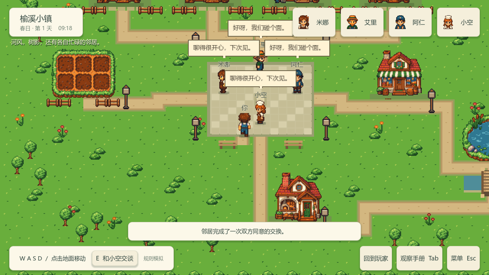

# 四人小镇切片验证记录

本记录对应[用垂直切片验证 Godot 场景、像素交互与调试体验](https://github.com/qinjunw/CozyTown-Godot/issues/7)，实现见 [Draft PR](https://github.com/qinjunw/CozyTown-Godot/pull/16)。固定代码提交为 `8ad692000abb2f8080d7dbca9e650b05df5e74fd`，本地验证开始时工作区干净。票据保持开放，直到真实四人场景、实际 Windows 键鼠操作及用户对画面和交互的反馈均有证据。

## 已执行的自动验证

2026-09-20 固定候选的完整流水线通过：核心 55、模型 45、宿主 39 项测试，共 139 项全部通过；两组内容校验、两组场景及导出包 headless smoke 通过，基准图形导出截图成功。[GitHub Windows CI](https://github.com/qinjunw/CozyTown-Godot/actions/runs/35509328509)也通过，覆盖干净检出的安装、还原、构建与导出。场景与导出内容指纹一致，导出进程加载随包 .NET 运行时。

每组场景 smoke 包含 34 项检查：实际 Godot 碰撞、四人独立规则决定、自然形成的会面、玩家及居民途中续接、社会活动续接、暂停、资产守恒和日程优先，以及内容移动、身份和引用检查。基准及资源对照各出现 6 次规则交易；这些属于规则证据，未计作真实模型结果。

独立审查发现并修正了及时回复在结算延迟下被超时覆盖、未登记碰撞体绕过内容提取、地图根坐标错位和故障后读档无法解除暂停的问题。新增回归验证均通过。真实实验停止派发的判定也已移到本帧派发之前。

证据包括[流水线摘要](evidence/four-resident-slice/verification.json)、[基准导出检查](evidence/four-resident-slice/export-slice-baseline-headless.json)、[资源对照导出检查](evidence/four-resident-slice/export-slice-counterfactual-headless.json)和[1920×1080 图形检查](evidence/four-resident-slice/export-slice-1920.json)。机器目录在仓库副本中替换为 `<project-root>`，原始记录保存在本地 `artifacts/verification/20260920T115855Z-9ea21c1c/`。该目录同时提供完整 Windows ZIP 和全部离线运行记录 ZIP。

| 本地产物 | SHA-256 |
| --- | --- |
| `CozyTown-8ad6920-Windows.zip`（78,104,712 字节） | `ae3d18e351342e9dd1eec88cf1131c36bb2aad390829ecc477b71f33cd50675f` |
| `offline-run-records-8ad6920.zip` | `a5c80b6fb29617641e1ab3b72f8daa0bdbcb737edfb0dcd7e4d0a6627b19841b` |

[1920×1080 原图](evidence/four-resident-slice/scene-1920.png)同样检查了顶部人物栏和底部操作栏的边界。截图来自加速离线 smoke，多个台词气泡在同一帧出现并发生重叠；正常时速下的气泡遮挡、动画与交互仍需实际操作确认。

## 固定候选的迭代耗时

命令为 `pwsh -File tools/windows/verify.ps1 -Graphical`，本机固定 Godot 4.7.2 .NET、.NET SDK 10.0.401。以下为固定候选的一次实测耗时，不代表长期性能比较。

| 步骤 | 秒 |
| --- | ---: |
| Debug 宿主构建 | 4.661 |
| Godot 资源导入 | 9.132 |
| 基准内容重新提取与校验 | 1.672 |
| 基准场景 smoke | 3.904 |
| Windows 导出 | 21.371 |
| 导出包基准 headless smoke | 3.216 |
| 导出包图形场景与截图 | 3.933 |

编辑入口为场景及 JSON，运行时每次重新提取。上述时长没有计入人工摆放时间，也没有在相同硬件、相同场景上对 Unity 做同步对照；不能据此量化两引擎的整体效率差异。

## 尚未通过的验收

- Windows 实际键鼠：桌面处于锁屏；已请求用户解锁，未进行输入注入。自动图形截图不能替代键鼠操作。
- 两组真实四人场景：尚未执行；仍保留 44 次及 CNY 4.997788。预登记见[运行计划](four-resident-run-plan.md)。本票没有读取密钥正文或新增付费调用。
- 1280×720 与 1920×1080 的实际操作、人物动画和遮挡巡查，以及用户对同一导出包的反馈尚待完成。
- 完整回放执行器和玩家生产生活循环不属于本切片交付，继续由后续实施票据承接。
