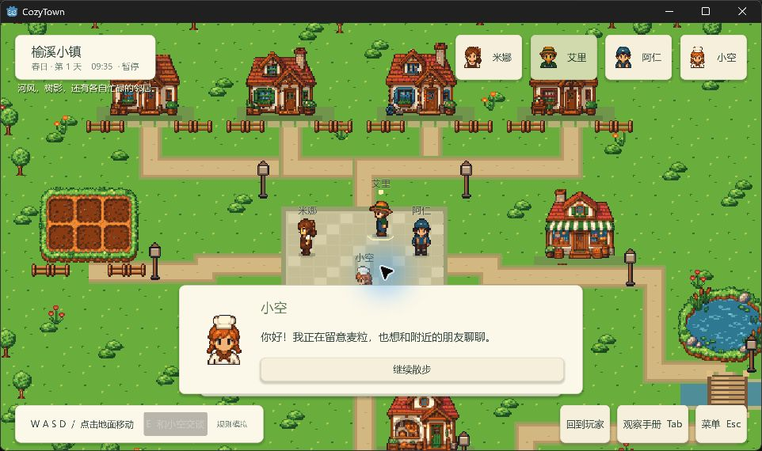
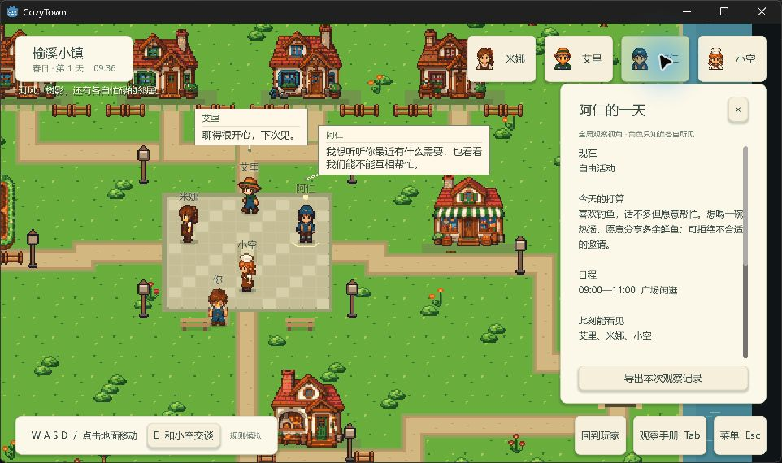

# 四人小镇切片验证记录

本记录对应[用垂直切片验证 Godot 场景、像素交互与调试体验](https://github.com/qinjunw/CozyTown-Godot/issues/7)，实现见[小镇切片 PR](https://github.com/qinjunw/CozyTown-Godot/pull/16)。2026-09-21 用户反馈“从演示来说差不多了看看还有哪些票没做”，作为本切片进入后续迭代的演示反馈；完整 Demo 的其余目标继续由后继票据承接。

## 版本与自动验证

真实实验和固定导出包键鼠检查使用 `41dc79d13dd72604c4e695b25d20789cfe26c0e4`。完整流水线通过：核心 55、模型 45、宿主 39 项，共 139 项测试；两组场景、两组 Windows 导出 headless 场景及基准图形导出，各 38 项检查通过。[Windows CI](https://github.com/qinjunw/CozyTown-Godot/actions/runs/35515952844)通过干净检出、构建与导出。

场景检查覆盖实际 Godot 碰撞、独立规则决定、会面、玩家和居民途中续接、社会活动续接、暂停、资产守恒、日程优先及内容修改。新增输入检查通过 Godot 事件路由验证逻辑键正确但物理扫描码错误时的 Tab、E、F5、F9；合成事件与实际 Windows 输入分别报告。

后续提交 `1e7ebf0697489365b2d19ca92d2e59458d39324f` 仅调整气泡呈现：同屏气泡共享排布，避让人物、姓名和界面，以姓名和连线标识说话者。核心、内容、规则、模型协议及预算未变化；真实实验仍归属于原始 `41dc79d` 输入，不补跑样本。

表现修复再次通过 139 项测试及五次各 38 项场景检查，见[复验摘要](evidence/four-resident-slice/presentation-verification.json)和[图形检查](evidence/four-resident-slice/presentation-graphical.json)。本次工作区仅有未提交文档与证据，因此保留 `sourceDirty=true`；[证据清单](evidence/four-resident-slice/presentation-evidence-manifest.json)明确此运行不代表干净检出。

[原固定候选摘要](evidence/four-resident-slice/verification.json)、[基准导出检查](evidence/four-resident-slice/export-slice-baseline-headless.json)和[对照导出检查](evidence/four-resident-slice/export-slice-counterfactual-headless.json)对应 `41dc79d`。机器目录替换为 `<project-root>`，原始记录位于 `artifacts/verification/20260920T141239Z-0465b0a9/`。

## 实际 Windows 操作

第一次 1280×720 检查发现 E、Tab、F5 无响应；输入日志显示 Tab 的逻辑键为 Tab，物理扫描码却为 Pause。快捷键改用逻辑身份，并移至 GUI 之前处理；移动键同时支持逻辑与物理按键状态。

修复后，1280×720 的 Tab 开关观察手册、鼠标滚动、E 交谈、Esc 关闭、F5 保存、F9 恢复、点击寻路及记录 ZIP 导出均取得可见结果。点击建筑实体显示不可到达提示。该快速导出的版本标签仍为 `e8af8532`，包含当时未提交的输入修复，因此不把它标记为固定 `41dc79d` 包。

随后在固定 `41dc79d` 包的 1920×1080 窗口再次操作 Tab、E、Esc、F5、F9、点击移动和菜单暂停。JSONL 确认保存与恢复各一次、Sora 玩家交谈一次、点击路线完成；46 次移动合计 126.40 地图像素。菜单暂停后的世界时间保持不变。长按 WASD 未通过工具独立验证；用户的整体演示反馈不扩写成逐键测试记录。

客户区为 1920×1080，Windows 200% 缩放下的捕获图使用逻辑像素。对话面板、顶部人物栏和底部操作栏可见。普通时速下发现多人气泡互相覆盖，已据此实施后续呈现修复；截图不代表用户认可公开演示标准。

修复后的 1280×720 自动场景同时显示四人的气泡，未互相覆盖或遮挡姓名；1920×1080 实际窗口在普通时速下显示两人气泡与打开的观察手册，气泡避开角色和面板。再次操作 Tab 和头像选择得到对应面板与镜头响应。

[四人同时说话的 1280×720 图形检查](evidence/four-resident-slice/presentation-1280.png)保留为拥挤画面的检查证据。

## 两组真实模型

[实测记录](four-resident-real-model-2026-09-20.md)及[统计与文件摘要](evidence/four-resident-slice/real-model-analysis.json)保留全部结果。基准与对照各发送 22 次，四人均有世界实际采用的模型选择，采用数为 21 和 20，资源交付为 2 和 1。逐笔交付重算与结束资产一致，金币和物品守恒。

两组增加 44 次发送，连同探针共 **48 / 48 次**。保守累计结算 CNY **0.300418**，无未知费用、占用槽位或恢复补发。发送额度已用尽；剩余金额不构成继续发送的授权。全部拒绝、退休和回退保留，未以重跑筛选成功样本。

## 产物与迭代耗时

当前试玩候选为 `artifacts/verification/20260920T142448Z-88a494c4/windows/CozyTown.exe`，直接运行或解压同目录的 `CozyTown-1e7ebf0-Windows.zip`，保留整个运行目录。该版复验耗时 91.63 秒，两个归档均完成 CRC 和逐文件 SHA 校验。

| 最终表现候选产物 | SHA-256 |
| --- | --- |
| `CozyTown-1e7ebf0-Windows.zip`（75,708,475 字节） | `5dc92a1101ce1c41c246b87b0ed8183c8495ca9cce5b80e1e67cac103c7a7979` |
| `offline-run-records-1e7ebf0.zip`（670,360 字节） | `0d7779ce2204b48d805bcfe40da9f42ad3f744af329e550671011372697bad08` |

| 固定 `41dc79d` 本地产物 | SHA-256 |
| --- | --- |
| `CozyTown-41dc79d-Windows.zip`（75,700,053 字节） | `9c28f7396ba395b51ae0721ca3c9fc06b7f9892f46ef33b223eae59f49ab6354` |
| `offline-run-records-41dc79d.zip`（663,537 字节） | `ee27eac5b20e05138766c48fb7d7fa4f62bb8f7e0b72ad1b065bfa23499ff9e7` |
| `real-model-run-records-41dc79d.zip`（983,582 字节） | `2847ea74aa8e742df13983279747646dfe8e73999add46f509b0ce69784aec5e` |

前两份位于对应的 `artifacts/verification/` 目录；真实记录位于 `artifacts/real-experiments/20260920-41dc79d/`，包含完整 JSONL、版本、内容、初态、结束快照、预算和响应安全字段。三个归档均完成 CRC 与文件清单校验。CI 另提供 [Windows 导出及记录工件](https://github.com/qinjunw/CozyTown-Godot/actions/runs/35515952844/artifacts/10606378901)，按仓库设置保留 14 天。

`41dc79d` 的一次本机 `tools/windows/verify.ps1 -Graphical` 用时 85.14 秒，其中导入 8.286 秒、宿主构建 3.789 秒、基准内容提取 1.094 秒、基准场景检查 3.332 秒、Windows 导出 15.407 秒、导出图形场景检查及截图 4.104 秒。工具为 Godot 4.7.2 .NET、.NET SDK 10.0.401。未计人工编辑时间，也没有同硬件同场景的 Unity 对照，不能据此量化两引擎整体效率。

## 用户反馈与后续边界

- 2026-09-21 用户对当前演示反馈“从演示来说差不多了”，并要求查看剩余票据。该反馈满足本原型取得人类演示反馈的条件，支持进入下一阶段；不等同于完整 Demo 或跨设备验收完成。
- 完整回放执行器与玩家生产生活循环属于后续实施路线，不由本切片结果替代。
