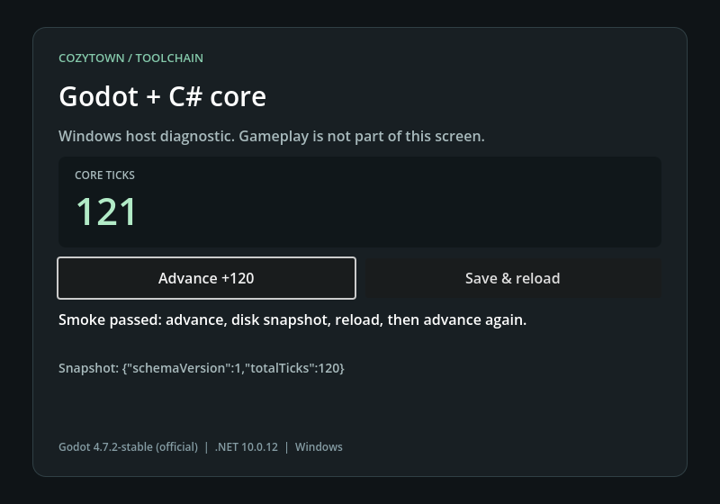

# Godot .NET Windows 工具链验证

日期：2026-09-19。票据：[验证 Windows Godot .NET 的最小构建与导出](https://github.com/qinjunw/CozyTown-Godot/issues/9)。验证输入为提交 `e227648f03f7fb33f25b7de977cafa6fb36302c2`；范围是独立核心引用、C# 场景执行和 Windows 交付链。

## 输入与方法

- 新建 detached worktree，目录名含空格；启动前没有 `.godot/`、`bin/`、`obj/`，验证前后 Git 状态均干净。复用已经校验的便携工具与 NuGet 包缓存。
- Windows `10.0.26200.0`，Intel Arc Graphics，OpenGL 3.3 Compatibility，驱动 `32.0.101.8243`。
- Godot `4.7.2.stable.mono.official.ed1daf0bf`，匹配的官方 .NET 模板；.NET SDK `10.0.401`、运行时 `10.0.12`；三个项目均目标 `net10.0`。
- 三个压缩包已计算摘要并与 [工具链锁](../../tools/windows/toolchain.lock.json) 对照。锁文件 SHA-256 为 `d743b7f66af0db06cca87b4f11bdd381f6319e3afef9a4333695d1839cb1c4ee`。
- 从工作树根目录运行 `tools/windows/verify.ps1 -ToolsRoot <portable-tools> -Graphical`。详细结果见 [results.json](windows-toolchain-2026-09-19/results.json)；其中机器路径已换成逻辑占位符。

## 结果

| 检查 | 观察结果 |
| --- | --- |
| 锁定依赖还原 | 宿主、核心和测试成功；导出 restore 也在 locked mode 下完成 |
| 独立核心测试 | 21/21 通过，覆盖恢复后继续运行、整数精度、非法输入与溢出保持原状态 |
| 首次导入与宿主构建 | 成功；Debug 宿主构建零警告、零错误 |
| 无界面 C# 场景 | 退出 0；通过内部按钮信号得到 `0 → 120 → 写盘恢复 120 → 121` |
| Windows ExportRelease | 导出成功，得到 EXE、PCK 和随包 .NET 数据目录 |
| 独立导出无界面运行 | 在导出目录运行并退出 0，行为断言全部通过 |
| 独立导出图形运行 | Windows 图形窗口运行并退出 0，行为断言通过，800×560 PNG 捕获成功 |
| 随包运行时 | 移除 SDK 的 PATH、将 DOTNET_ROOT 指向不存在的目录后，`System.Private.CoreLib` 实际从导出数据目录加载 |
| 失败入口 | smoke 缺少报告参数时退出 1，并给出所需绝对路径的错误 |

截图已检查：标题、计数 121、两个按钮、恢复后继续运行的结果和运行时信息均可见，没有文字裁切。

## 已处理的构建约束

Godot 导出使用 `win-x64`，且 Debug 比 ExportRelease 多引用 `GodotSharpEditor`。宿主按配置分开锁文件，宿主与核心预声明 Windows RID；同一套锁因此支持编辑器构建和发行导出。

验证期间实际出现过 .NET publish 失败而 Godot 退出码仍为 0 的情况。验证脚本通过 `ERROR:` 日志检测将其判为失败；修复锁文件后，导出日志与行为检查共同通过。超时也会终止子进程树并保存输出。

## 采用结论与限制

后继切片采用本次实测的 Godot 4.7.2 .NET、SDK 10.0.401 与 `net10.0`，未执行 net8 对照。操作入口见 [Windows 构建与验证](../WINDOWS_TOOLCHAIN.md)。

本结果只覆盖工具链探针。内部 `Pressed` 信号没有验证真人键鼠输入；截图没有验收正式美术。完整玩法、四人 Agent、完整逻辑快照及回放合同仍按产品票据推进。图形结果来自上述单台设备；未验证其他显卡、签名发行或完全未安装 .NET 的本地 Windows 系统。远端 CI 结果由对应 PR 的检查和运行记录保存，不由本地结果推定。
